# Data model

Generated from `lib/db/src/schema/*.ts` (one file per table group). Phase 02 tables use UUID primary keys; the phase 03 auth tables (`users`, `sessions`, `accounts`, `verifications`, `two_factors`, `devices`, `auth_lockouts`) keep Better Auth's **text** ids, so every column that points at a user (`user_id`, `author_id`, `reviewer_id`, ...) is `text`. All tables have `created_at`/`updated_at` (except the append-only `audit_log`, which has only `created_at`, and `auth_lockouts`), and content tables carry a nullable `deleted_at` for soft delete. Diagrams below show primary keys, foreign keys and key business columns only; the schema files are the source of truth for every column.

Cardinality: `||--o{` = one-to-many (the child's foreign key is NOT NULL: a child must have a parent); `|o--o{` = optional parent (nullable foreign key). Cascade rules are listed in the table at the end.

## Users and sessions

```mermaid
erDiagram
    accounts {
        uuid id PK
    }
    auth_lockouts {
        text email
    }
    devices {
        uuid id PK
    }
    sessions {
        uuid id PK
        text impersonatedBy FK
    }
    two_factors {
        uuid id PK
    }
    user_profiles {
        uuid targetExamId FK
    }
    users {
        uuid id PK
        text email
        text role
        text status
    }
    verifications {
        uuid id PK
    }
    blog_posts {
        uuid id PK
        text slug
        uuid cover_asset_id FK
        text author_id FK
        enum status
    }
    bookmarks {
        uuid id PK
        text user_id FK
    }
    card_reviews {
        uuid id PK
        uuid flashcard_id FK
        text user_id FK
    }
    certificates {
        uuid id PK
        text user_id FK
        uuid course_id FK
        text code
    }
    contact_messages {
        uuid id PK
        text user_id FK
        text email
        enum status
    }
    coupon_redemptions {
        uuid id PK
        uuid coupon_id FK
        text user_id FK
        uuid subscription_id FK
    }
    courses {
        uuid id PK
        uuid exam_id FK
        text slug
        uuid cover_asset_id FK
        text instructor_id FK
        enum status
    }
    email_log {
        uuid id PK
        text user_id FK
        text status
    }
    entitlements {
        uuid id PK
        text user_id FK
        uuid exam_id FK
        uuid subscription_id FK
        text granted_by FK
    }
    exams {
        uuid id PK
        text slug
        enum status
    }
    flashcards {
        uuid id PK
        text user_id FK
        uuid question_id FK
        uuid topic_id FK
    }
    invoices {
        uuid id PK
        text user_id FK
        uuid subscription_id FK
        text status
    }
    lesson_notes {
        uuid id PK
        text user_id FK
        uuid lesson_id FK
    }
    lesson_progress {
        uuid id PK
        text user_id FK
        uuid lesson_id FK
    }
    licence_seats {
        uuid id PK
        uuid licence_id FK
        text user_id FK
    }
    licences {
        uuid id PK
        text owner_id FK
        uuid exam_id FK
    }
    media_assets {
        uuid id PK
        text uploaded_by FK
    }
    osce_attempts {
        uuid id PK
        text user_id FK
        uuid station_id FK
        uuid circuit_id FK
        uuid room_id FK
        enum role
        enum status
    }
    osce_circuits {
        uuid id PK
        text user_id FK
        uuid exam_id FK
        enum status
    }
    osce_rooms {
        uuid id PK
        text code
        uuid station_id FK
        text host_id FK
        text candidate_id FK
        text examiner_id FK
        enum status
    }
    osce_stations {
        uuid id PK
        uuid exam_id FK
        uuid topic_id FK
        text slug
        enum status
        text reviewer_id FK
    }
    question_flags {
        uuid id PK
        text user_id FK
        uuid question_id FK
    }
    question_notes {
        uuid id PK
        text user_id FK
        uuid question_id FK
    }
    question_reports {
        uuid id PK
        uuid question_id FK
        text user_id FK
        enum status
        text resolved_by FK
    }
    question_versions {
        uuid id PK
        uuid question_id FK
        text changed_by FK
    }
    questions {
        uuid id PK
        uuid exam_id FK
        uuid media_asset_id FK
        uuid difficulty_id FK
        enum status
        text author_id FK
        text reviewer_id FK
    }
    quiz_answers {
        uuid id PK
        uuid session_question_id FK
        text user_id FK
        uuid question_id FK
        uuid selected_option_id FK
    }
    quiz_sessions {
        uuid id PK
        text user_id FK
        uuid exam_id FK
        enum status
    }
    study_plans {
        uuid id PK
        text user_id FK
        uuid exam_id FK
    }
    subscriptions {
        uuid id PK
        text user_id FK
        uuid plan_id FK
        enum status
    }
    exams |o--o{ user_profiles : "targetExamId"
    users |o--o{ blog_posts : "author_id"
    users ||--o{ bookmarks : "user_id"
    users ||--o{ card_reviews : "user_id"
    users ||--o{ certificates : "user_id"
    users |o--o{ contact_messages : "user_id"
    users ||--o{ coupon_redemptions : "user_id"
    users |o--o{ courses : "instructor_id"
    users |o--o{ email_log : "user_id"
    users |o--o{ entitlements : "granted_by"
    users ||--o{ entitlements : "user_id"
    users ||--o{ flashcards : "user_id"
    users ||--o{ invoices : "user_id"
    users ||--o{ lesson_notes : "user_id"
    users ||--o{ lesson_progress : "user_id"
    users |o--o{ licence_seats : "user_id"
    users |o--o{ licences : "owner_id"
    users |o--o{ media_assets : "uploaded_by"
    users ||--o{ osce_attempts : "user_id"
    users ||--o{ osce_circuits : "user_id"
    users |o--o{ osce_rooms : "candidate_id"
    users |o--o{ osce_rooms : "examiner_id"
    users ||--o{ osce_rooms : "host_id"
    users |o--o{ osce_stations : "reviewer_id"
    users ||--o{ question_flags : "user_id"
    users ||--o{ question_notes : "user_id"
    users |o--o{ question_reports : "resolved_by"
    users |o--o{ question_reports : "user_id"
    users |o--o{ question_versions : "changed_by"
    users |o--o{ questions : "author_id"
    users |o--o{ questions : "reviewer_id"
    users ||--o{ quiz_answers : "user_id"
    users ||--o{ quiz_sessions : "user_id"
    users |o--o{ sessions : "impersonatedBy"
    users ||--o{ study_plans : "user_id"
    users ||--o{ subscriptions : "user_id"
```

## Exams

```mermaid
erDiagram
    banners {
        uuid id PK
        uuid exam_id FK
        enum status
    }
    exam_dates {
        uuid id PK
        uuid exam_id FK
        enum status
    }
    exam_documents {
        uuid id PK
        uuid exam_id FK
    }
    exam_faqs {
        uuid id PK
        uuid exam_id FK
        enum status
    }
    exams {
        uuid id PK
        text slug
        enum status
    }
    courses {
        uuid id PK
        uuid exam_id FK
        text slug
        uuid cover_asset_id FK
        text instructor_id FK
        enum status
    }
    entitlements {
        uuid id PK
        text user_id FK
        uuid exam_id FK
        uuid subscription_id FK
        text granted_by FK
    }
    licences {
        uuid id PK
        text owner_id FK
        uuid exam_id FK
    }
    osce_circuits {
        uuid id PK
        text user_id FK
        uuid exam_id FK
        enum status
    }
    osce_stations {
        uuid id PK
        uuid exam_id FK
        uuid topic_id FK
        text slug
        enum status
        text reviewer_id FK
    }
    plans {
        uuid id PK
        uuid exam_id FK
        text slug
        enum status
    }
    questions {
        uuid id PK
        uuid exam_id FK
        uuid media_asset_id FK
        uuid difficulty_id FK
        enum status
        text author_id FK
        text reviewer_id FK
    }
    quiz_sessions {
        uuid id PK
        text user_id FK
        uuid exam_id FK
        enum status
    }
    study_plans {
        uuid id PK
        text user_id FK
        uuid exam_id FK
    }
    topics {
        uuid id PK
        uuid parent_id FK
        uuid exam_id FK
        text slug
    }
    user_profiles {
        uuid targetExamId FK
    }
    exams |o--o{ banners : "exam_id"
    exams |o--o{ courses : "exam_id"
    exams ||--o{ entitlements : "exam_id"
    exams ||--o{ exam_dates : "exam_id"
    exams ||--o{ exam_documents : "exam_id"
    exams ||--o{ exam_faqs : "exam_id"
    exams |o--o{ licences : "exam_id"
    exams |o--o{ osce_circuits : "exam_id"
    exams |o--o{ osce_stations : "exam_id"
    exams |o--o{ plans : "exam_id"
    exams ||--o{ questions : "exam_id"
    exams |o--o{ quiz_sessions : "exam_id"
    exams ||--o{ study_plans : "exam_id"
    exams |o--o{ topics : "exam_id"
    exams |o--o{ user_profiles : "targetExamId"
```

## Taxonomy

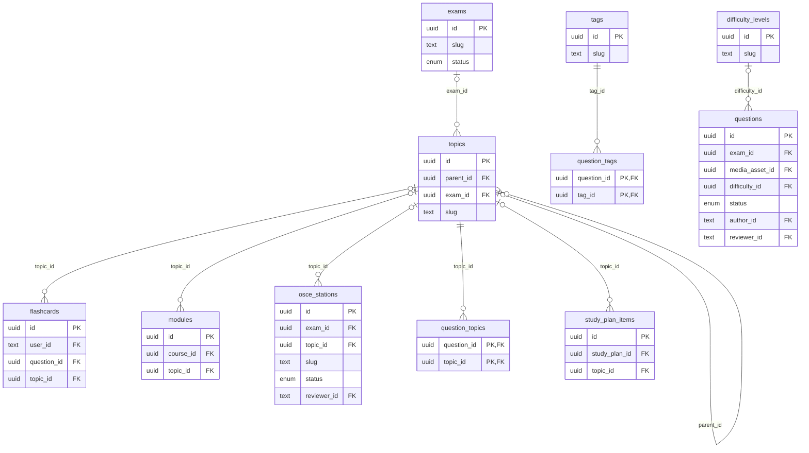

## Questions

```mermaid
erDiagram
    question_lessons {
        uuid question_id PK,FK
        uuid lesson_id PK,FK
    }
    question_options {
        uuid id PK
        uuid question_id FK
    }
    question_reports {
        uuid id PK
        uuid question_id FK
        text user_id FK
        enum status
        text resolved_by FK
    }
    question_stats {
        uuid id PK
        uuid question_id FK
    }
    question_tags {
        uuid question_id PK,FK
        uuid tag_id PK,FK
    }
    question_topics {
        uuid question_id PK,FK
        uuid topic_id PK,FK
    }
    question_versions {
        uuid id PK
        uuid question_id FK
        text changed_by FK
    }
    questions {
        uuid id PK
        uuid exam_id FK
        uuid media_asset_id FK
        uuid difficulty_id FK
        enum status
        text author_id FK
        text reviewer_id FK
    }
    difficulty_levels {
        uuid id PK
        text slug
    }
    exams {
        uuid id PK
        text slug
        enum status
    }
    flashcards {
        uuid id PK
        text user_id FK
        uuid question_id FK
        uuid topic_id FK
    }
    lessons {
        uuid id PK
        uuid module_id FK
        text slug
        uuid asset_id FK
        enum status
    }
    media_assets {
        uuid id PK
        text uploaded_by FK
    }
    question_flags {
        uuid id PK
        text user_id FK
        uuid question_id FK
    }
    question_notes {
        uuid id PK
        text user_id FK
        uuid question_id FK
    }
    quiz_answers {
        uuid id PK
        uuid session_question_id FK
        text user_id FK
        uuid question_id FK
        uuid selected_option_id FK
    }
    quiz_session_questions {
        uuid id PK
        uuid session_id FK
        uuid question_id FK
    }
    tags {
        uuid id PK
        text slug
    }
    topics {
        uuid id PK
        uuid parent_id FK
        uuid exam_id FK
        text slug
    }
    users {
        uuid id PK
        text email
        text role
        text status
    }
    difficulty_levels |o--o{ questions : "difficulty_id"
    exams ||--o{ questions : "exam_id"
    lessons ||--o{ question_lessons : "lesson_id"
    media_assets |o--o{ questions : "media_asset_id"
    question_options |o--o{ quiz_answers : "selected_option_id"
    questions |o--o{ flashcards : "question_id"
    questions ||--o{ question_flags : "question_id"
    questions ||--o{ question_lessons : "question_id"
    questions ||--o{ question_notes : "question_id"
    questions ||--o{ question_options : "question_id"
    questions ||--o{ question_reports : "question_id"
    questions ||--o{ question_stats : "question_id"
    questions ||--o{ question_tags : "question_id"
    questions ||--o{ question_topics : "question_id"
    questions ||--o{ question_versions : "question_id"
    questions ||--o{ quiz_answers : "question_id"
    questions ||--o{ quiz_session_questions : "question_id"
    tags ||--o{ question_tags : "tag_id"
    topics ||--o{ question_topics : "topic_id"
    users |o--o{ question_reports : "resolved_by"
    users |o--o{ question_reports : "user_id"
    users |o--o{ question_versions : "changed_by"
    users |o--o{ questions : "author_id"
    users |o--o{ questions : "reviewer_id"
```

## Quizzes (question-bank sessions)

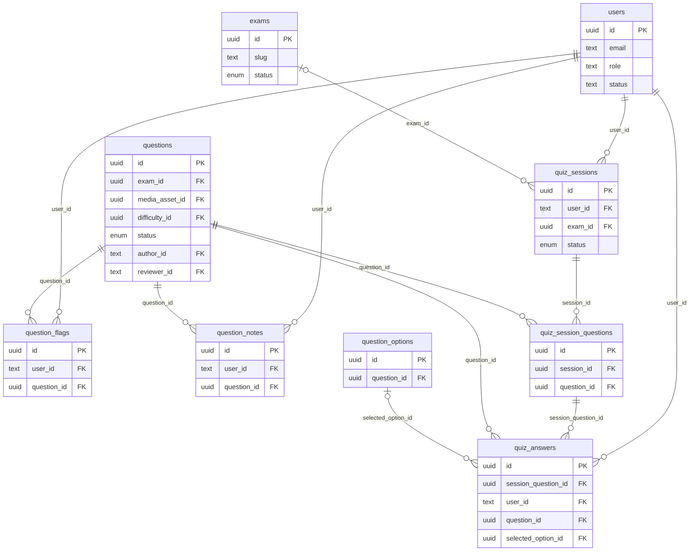

## OSCE

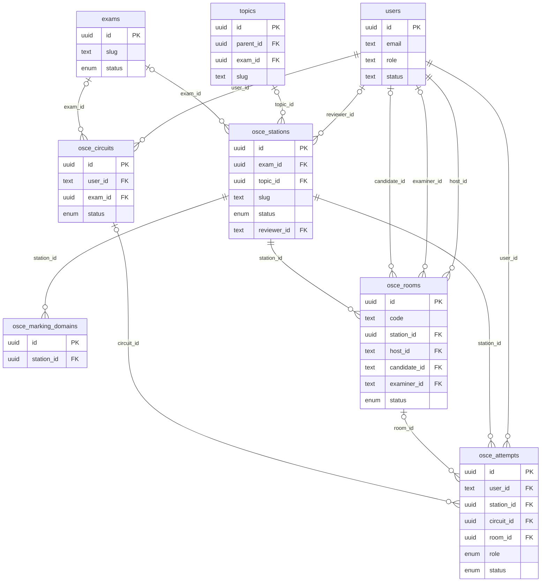

## Courses and media

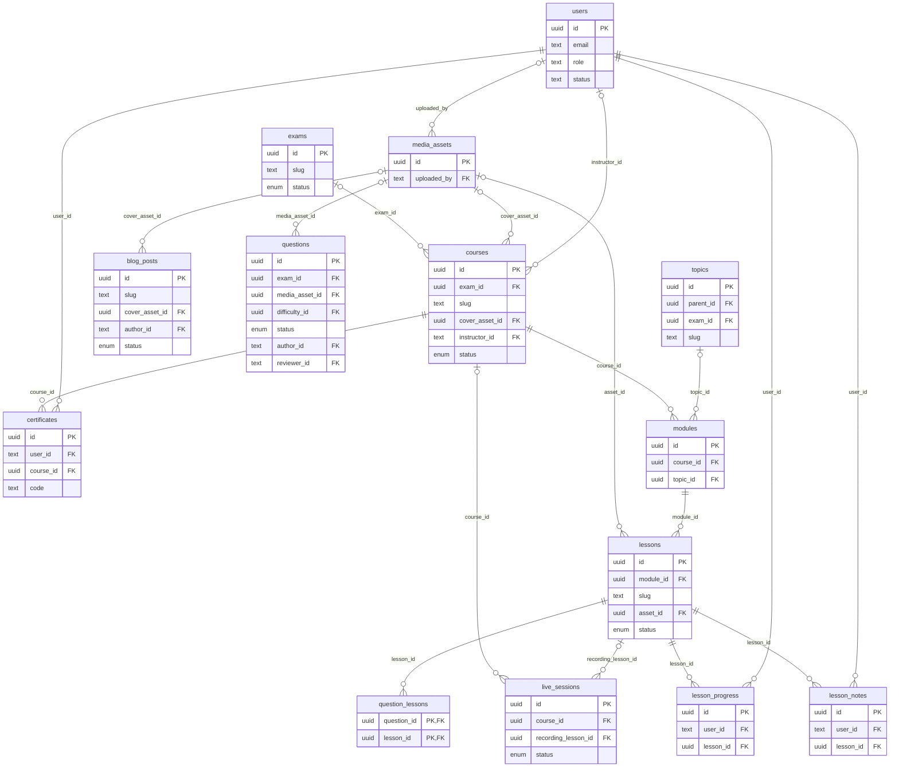

## Learning tools

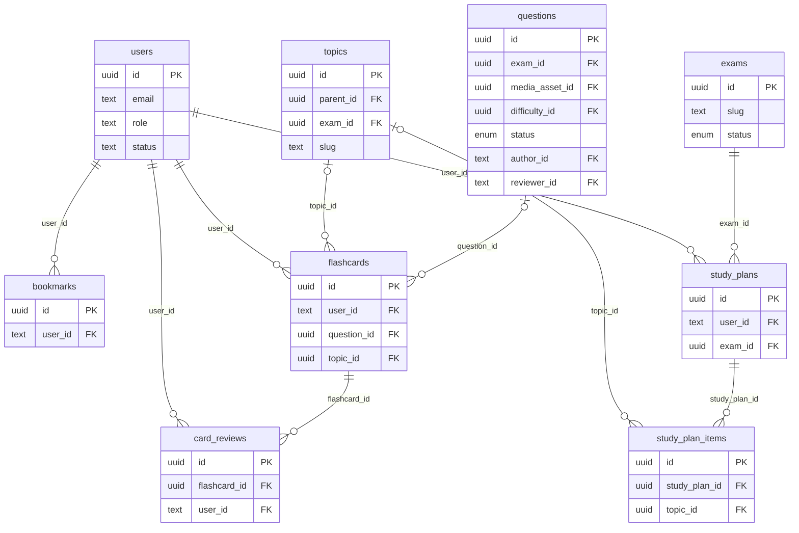

## Billing and access

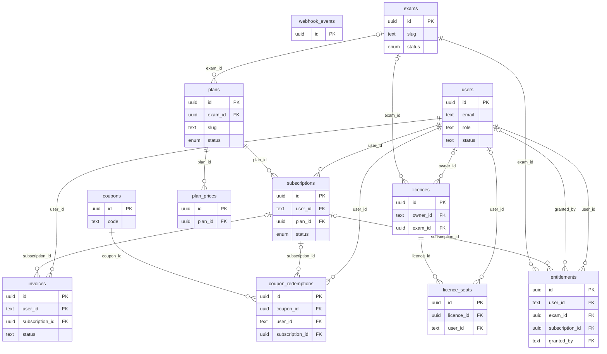

## Content, email and settings

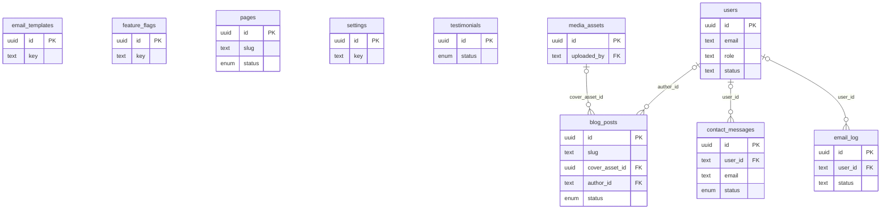

## Audit

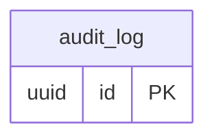

## Foreign-key delete rules

| Child | Column | Parent | On parent delete |
|---|---|---|---|
| `banners` | `exam_id` | `exams` | cascade |
| `blog_posts` | `author_id` | `users` | no action |
| `blog_posts` | `cover_asset_id` | `media_assets` | no action |
| `bookmarks` | `user_id` | `users` | cascade |
| `card_reviews` | `flashcard_id` | `flashcards` | cascade |
| `card_reviews` | `user_id` | `users` | cascade |
| `certificates` | `course_id` | `courses` | cascade |
| `certificates` | `user_id` | `users` | cascade |
| `contact_messages` | `user_id` | `users` | no action |
| `coupon_redemptions` | `coupon_id` | `coupons` | restrict |
| `coupon_redemptions` | `subscription_id` | `subscriptions` | no action |
| `coupon_redemptions` | `user_id` | `users` | cascade |
| `courses` | `cover_asset_id` | `media_assets` | no action |
| `courses` | `exam_id` | `exams` | no action |
| `courses` | `instructor_id` | `users` | no action |
| `email_log` | `user_id` | `users` | no action |
| `entitlements` | `exam_id` | `exams` | cascade |
| `entitlements` | `granted_by` | `users` | no action |
| `entitlements` | `subscription_id` | `subscriptions` | no action |
| `entitlements` | `user_id` | `users` | cascade |
| `exam_dates` | `exam_id` | `exams` | cascade |
| `exam_documents` | `exam_id` | `exams` | cascade |
| `exam_faqs` | `exam_id` | `exams` | cascade |
| `flashcards` | `question_id` | `questions` | no action |
| `flashcards` | `topic_id` | `topics` | no action |
| `flashcards` | `user_id` | `users` | cascade |
| `invoices` | `subscription_id` | `subscriptions` | no action |
| `invoices` | `user_id` | `users` | cascade |
| `lesson_notes` | `lesson_id` | `lessons` | cascade |
| `lesson_notes` | `user_id` | `users` | cascade |
| `lesson_progress` | `lesson_id` | `lessons` | cascade |
| `lesson_progress` | `user_id` | `users` | cascade |
| `lessons` | `asset_id` | `media_assets` | no action |
| `lessons` | `module_id` | `modules` | cascade |
| `licence_seats` | `licence_id` | `licences` | cascade |
| `licence_seats` | `user_id` | `users` | no action |
| `licences` | `exam_id` | `exams` | no action |
| `licences` | `owner_id` | `users` | no action |
| `live_sessions` | `course_id` | `courses` | no action |
| `live_sessions` | `recording_lesson_id` | `lessons` | no action |
| `media_assets` | `uploaded_by` | `users` | no action |
| `modules` | `course_id` | `courses` | cascade |
| `modules` | `topic_id` | `topics` | no action |
| `osce_attempts` | `circuit_id` | `osce_circuits` | no action |
| `osce_attempts` | `room_id` | `osce_rooms` | no action |
| `osce_attempts` | `station_id` | `osce_stations` | restrict |
| `osce_attempts` | `user_id` | `users` | cascade |
| `osce_circuits` | `exam_id` | `exams` | no action |
| `osce_circuits` | `user_id` | `users` | cascade |
| `osce_marking_domains` | `station_id` | `osce_stations` | cascade |
| `osce_rooms` | `candidate_id` | `users` | no action |
| `osce_rooms` | `examiner_id` | `users` | no action |
| `osce_rooms` | `host_id` | `users` | cascade |
| `osce_rooms` | `station_id` | `osce_stations` | cascade |
| `osce_stations` | `exam_id` | `exams` | no action |
| `osce_stations` | `reviewer_id` | `users` | no action |
| `osce_stations` | `topic_id` | `topics` | no action |
| `plan_prices` | `plan_id` | `plans` | cascade |
| `plans` | `exam_id` | `exams` | no action |
| `question_flags` | `question_id` | `questions` | cascade |
| `question_flags` | `user_id` | `users` | cascade |
| `question_lessons` | `lesson_id` | `lessons` | cascade |
| `question_lessons` | `question_id` | `questions` | cascade |
| `question_notes` | `question_id` | `questions` | cascade |
| `question_notes` | `user_id` | `users` | cascade |
| `question_options` | `question_id` | `questions` | cascade |
| `question_reports` | `question_id` | `questions` | cascade |
| `question_reports` | `resolved_by` | `users` | no action |
| `question_reports` | `user_id` | `users` | no action |
| `question_stats` | `question_id` | `questions` | cascade |
| `question_tags` | `question_id` | `questions` | cascade |
| `question_tags` | `tag_id` | `tags` | cascade |
| `question_topics` | `question_id` | `questions` | cascade |
| `question_topics` | `topic_id` | `topics` | cascade |
| `question_versions` | `changed_by` | `users` | no action |
| `question_versions` | `question_id` | `questions` | cascade |
| `questions` | `author_id` | `users` | no action |
| `questions` | `difficulty_id` | `difficulty_levels` | no action |
| `questions` | `exam_id` | `exams` | restrict |
| `questions` | `media_asset_id` | `media_assets` | no action |
| `questions` | `reviewer_id` | `users` | no action |
| `quiz_answers` | `question_id` | `questions` | restrict |
| `quiz_answers` | `selected_option_id` | `question_options` | no action |
| `quiz_answers` | `session_question_id` | `quiz_session_questions` | cascade |
| `quiz_answers` | `user_id` | `users` | cascade |
| `quiz_session_questions` | `question_id` | `questions` | restrict |
| `quiz_session_questions` | `session_id` | `quiz_sessions` | cascade |
| `quiz_sessions` | `exam_id` | `exams` | no action |
| `quiz_sessions` | `user_id` | `users` | cascade |
| `sessions` | `impersonatedBy` | `users` | no action |
| `study_plan_items` | `study_plan_id` | `study_plans` | cascade |
| `study_plan_items` | `topic_id` | `topics` | no action |
| `study_plans` | `exam_id` | `exams` | cascade |
| `study_plans` | `user_id` | `users` | cascade |
| `subscriptions` | `plan_id` | `plans` | restrict |
| `subscriptions` | `user_id` | `users` | cascade |
| `topics` | `exam_id` | `exams` | no action |
| `topics` | `parent_id` | `topics` | restrict |
| `user_profiles` | `targetExamId` | `exams` | no action |

Rules of thumb: per-user data **cascades** when the user is deleted (GDPR erasure); shared content is **restricted** or **set null** so history is never silently lost (for example, answers keep pointing at a question that is archived, and the question cannot be hard-deleted while answers exist). Content is **soft-deleted** (`deleted_at`) instead.

## Key constraints and indexes

- Idempotency: `webhook_events.stripe_event_id` (unique), `invoices.stripe_invoice_id`, `subscriptions.stripe_subscription_id`, `coupon_redemptions (coupon_id, user_id)`, `lesson_progress (user_id, lesson_id)`, `quiz_answers (session_question_id)`, `question_flags (user_id, question_id)`, `bookmarks (user_id, target_type, target_id)`.
- Natural keys: `users.email`, `exams.slug`, `topics.slug`, `courses.slug`, `plans.slug`, `osce_stations.slug`, `osce_rooms.code`, `certificates.code`, `coupons.code`, `feature_flags.key`, `settings.key`.
- Plan-mandated indexes: `(user_id, created_at)` on every per-user table, `(question_id)` on option/answer/report/stat tables, `(topic_id)` on `question_topics`, `topics`, `modules`, `flashcards`, `osce_stations`, and `(exam_id, status)` on `questions`, `osce_stations`, `quiz_sessions`, `exam_faqs`, `exam_dates`, `courses`, `plans`.
- `question_stats (question_id, day)` is unique so the daily rollup job can upsert.
- `plan_prices.region` is NOT NULL with default `'ALL'` so the `(plan_id, currency, region)` unique index also protects the default price.

## Deliberate design notes

- `bookmarks.target_id` is polymorphic (question, lesson or station), so it has no foreign key; the service layer validates it.
- Tables are named with the plan's names. Two small additions beyond section 6 of the plan: `difficulty_levels` (the plan lists "difficulty and source lists" in the admin taxonomy module) and `question_tags` (join table for tags).
- Auth tables come from phase 03 and were only extended with nullable/defaulted columns: `users.status`, `users.last_seen_at`, `sessions.impersonated_by`, `user_profiles.{grade,target_exam_id,daily_goal_questions,marketing_opt_in,preferences}`, `audit_log.{impersonator_id,user_agent}`. `user_profiles.target_exam` (free text, used by the phase 03 account form) is kept next to the structured `target_exam_id`; migrate the form in phase 04. `audit_log.actor_id` deliberately has no foreign key so entries survive account deletion.
- Server-authoritative timing: `quiz_sessions.deadline_at` is computed on the server; the client only displays it.
